# 0012 — Design standards (draft)

**Status: draft, partly decided (see §10). Not authoritative until the open gaps are settled.** This doc records what the app does today (v0.6.19, 2026-11-04) and proposes standards where the app is inconsistent. Per `.claude/CLAUDE.md` a doc still being written cannot override a decided item in another doc. Nothing here is scope: build from the roadmap, not from this doc, until the gaps in §10 are settled and the roadmap covers the work.

How to read it:

- **Observed** — measured in the running app (headless Chromium, 1024px and 400px wide, seeded sample data). Numbers are CSS pixels.
- **Proposed** — my suggested standard. Needs your yes or no.
- **Gap `G#`** — I could not define it, or I have a question. All gaps are in §10.

Images are low resolution on purpose (`images/0012/`). The app's UI was partly mid-build (v0.6 group C) when they were taken.

Source of values: `src/styles/tokens.css`, `src/App.css`, `src/components/**`.
Related docs: `0004` (table), `0007` §4–§10, `0008`, `0009`, `0005` (review checklist).
Roadmap items this touches: v0.6 hover styling (9a), v0.7 dialog consolidation, v0.7 form field alignment class, v0.7 1440px max width, v0.7 sticky item column and 250px minimum.

## 1. Tokens

Observed (`tokens.css`). Everything below is a variable; there are no inline styles.

| Group | Tokens |
|---|---|
| Page and text | background `#ffffff`, foreground `#1a1a1a`, text `#000000`, description text `#4b5563` |
| Buttons | primary `#5c2e0a` (hover `#3f1f06`), secondary `#6b7280`, text on both `#ffffff` |
| Status | alert `#b91c1c` (hover `#8f1818`), success `#15803d`, info `#0284c7`, warn `#a16207` |
| Lines | border `#e5e7eb` |
| Category colors | blue, red, highlight-blue, green, lighter-green, orange, lighter-orange, even-lighter-orange (0004) |
| Spacing | xs 4, sm 8, md 16, lg 24, xl 32 |
| Type | sm 14, base 16, lg 20, xl 24; weights 400 and 700; system-ui stack |
| Radius | sm 4, md 8 |

Used but not tokenized (hard-coded in `App.css`):

- Control height 44px; table touch targets 2.75rem (44px) — same number, two units.
- Dialog widths (32rem, 40rem, 44rem, 64rem, 1100px), table min widths (500px, 250px planned, 7.5rem amount columns), field max width (40rem).
- Shadows: `0 6px 18px rgb(0 0 0 / .15)` (menus, listbox). Backdrop `rgb(0 0 0 / .5)`.
- Focus ring: 3px `--color-info`, offset 2px (−3px inside tables and menus).
- Banner tints use `color-mix(... white 90–92%)`; the two differ by 2 points (G1).

**Proposed:** add tokens for control height, dialog widths (small / medium / large), field
width, and the two shadows, so widths stop being per-dialog numbers.

## 2. Layout and breakpoints

Observed:

- Page: single column, `.main` max 900px, padding 16 (<640), 24 (≥640), 32 (≥1280); the 900px column sits on a tinted page background at ≥900px.
- Breakpoints: 640 and 1280 in CSS (0007 §10 names 320 / 640 / 1280). The tab strip becomes a "Screens" menu below the WIDE breakpoint (Tabs.tsx).
- Section gap 32; panel gap 16; form-grid gap 16, two columns at ≥1280.
- Sticky: table header row; Budget setup footer (unstuck when viewport height ≤480).
- Decided, not built: max app width 1440px, sticky item column above 500px with a 250px minimum (roadmap v0.7). The current max is 900px, so 1440px is a large change (G2).

## 3. Controls

### Buttons — observed

| Variant | Class | Look |
|---|---|---|
| Primary | `.btn` | brown fill, white text, 2px border, radius 8 |
| Secondary | `.btn.secondary` | white fill, brown text and border |
| Danger | `.btn.danger` | red fill |
| Toggle / choice | `.btn.toggle`, `.choice-button` | pressed = brown fill; radios drawn as buttons |
| Icon | `.btn.icon`, `.chevron`, `.help-btn` | borderless (pencil), bordered (nav chevrons), round (help) |
| Small | `.btn.small` | table row buttons |

All are at least 44×44. Hover is defined for most (v0.6 step 9a). A confirm dialog's Delete
button is **primary brown**, while the purchase dialog's Delete is **danger red**
(compare `c-delete-confirm` and `c-purchase-edit` below) (G3).

### Inputs — observed

- Text, select and date: min height 44, 1px grey border, radius 4, padding 8. Invalid =
  2px red border. Required = `*` after the label (aria-hidden).
- Width by place:

| Place | Control width at 1024px |
|---|---|
| Add purchase (every field, including Amount and Date) | 640 (the 40rem field limit) |
| Small dialogs (Rename, New purchase, Add/Subtract) | 464 (fills the dialog) |
| Purchase dialog | 592 (fills the dialog) |
| Budget setup: estimate / recurrence / schedule | 128 / 257 / 126 |
| Budget setup: week start | 256 |
| Backup file chooser | 640 |

- An `.amount` class (8rem) exists but both Add purchase and the dialogs show Amount at
  full width, so amount fields are never narrower than text fields (G4).

## 4. Form anatomy (the main inconsistency)

Two separate form implementations build fields, and they place help text differently:

| Form | Code | Order | Label→control gap |
|---|---|---|---|
| Add purchase, purchase dialog | `PurchaseForm.tsx` | label, **help**, control, error | 29px (one help line), 50px (two), 71px (three, narrow) |
| Fields with no help (Date, Description in dialogs) | either | label, control | 4px |
| Rename, Add/Subtract Date | `EditDialogs.tsx` `Field` | label, control, **help**, error | 4px |
| Add/Subtract, New purchase Amount | `AmountDialog` | **intro paragraph above the form**, label, control | 4px |

So help sits above the control in one place, below it in another, and above the label in a third. A row of fields shown side by side will not line up (the point of the v0.7 alignment class). Add purchase also mixes 29px and 4px gaps between its own fields (Date has no help).

Other observed differences:

- Required marker: Add purchase and the purchase dialog show `*`; Add/Subtract, New purchase and Rename do not mark their required fields (G5).
- Optional marker: "Description" in Add purchase and the purchase dialog, but
  "Description (optional)" in the New purchase dialog.
- Error text: red, bold, 14px, under the control; plus a summary banner on Add purchase only.
- Field group spacing: 16 (`dialog-form`, `panel`), 24 in setup settings.

**Proposed standard** (one `Field` component for every form):

1. Order: label, then help text, then control, then error. Help is always above the control so it is read before typing.
2. A fixed space below the label and below the help, equal whether help is present or not (the v0.7 class: reserve the help line's height, so columns align).
3. Required fields marked `*` everywhere, or optional fields marked "(optional)"
   everywhere — not both (G5).
4. Control width: every control fills its container minus its margin (G4).

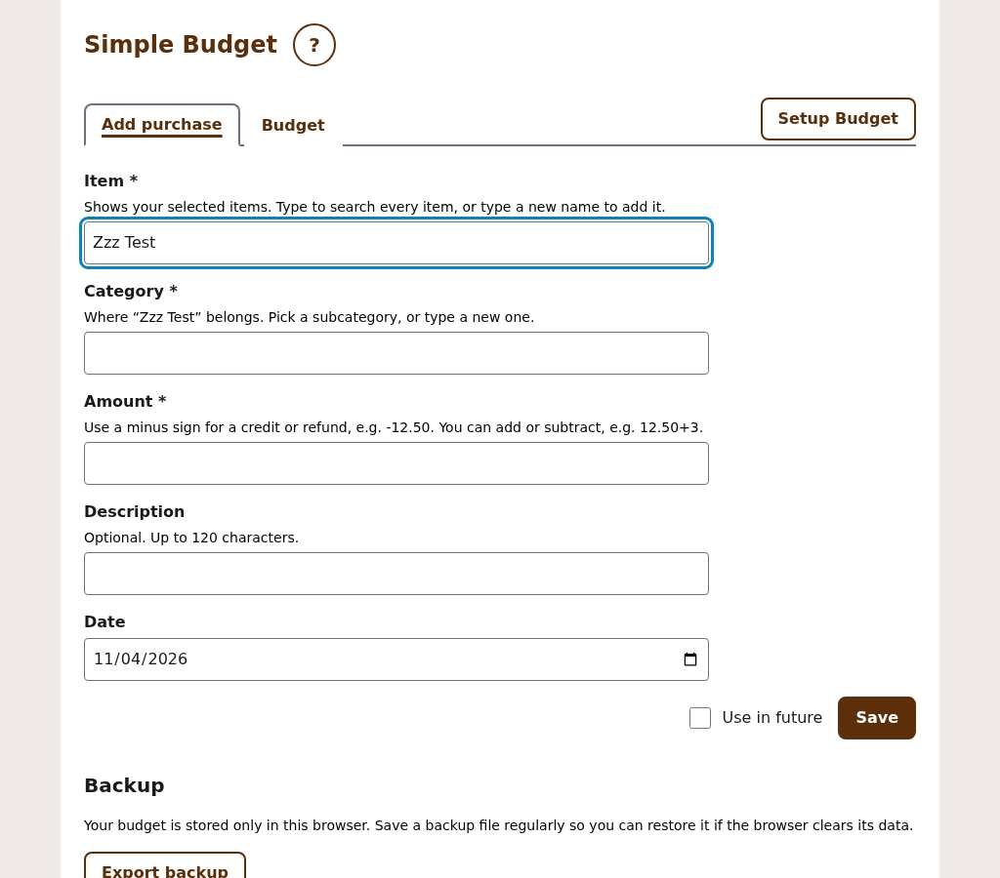

*Add purchase: label, help line, control. The Date field has no help line, so its gap is
4px while the others are 29px.*

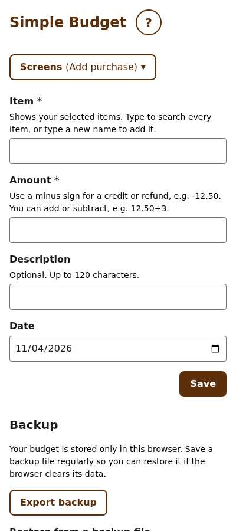

## 5. Dialogs

Observed. Four implementations, not the three in the roadmap: `Dialog` (generic),
`FormDialog` (form), `ConfirmDialog` (confirm), and **Budget setup**, which is a raw
`<dialog>` with its own CSS (`dialog.setup`).

| Dialog | Width (1024px) | Title | Footer |
|---|---|---|---|
| Rename | 512 (32rem) | "Rename {name}" | Cancel left, Save right |
| New purchase / Add/Subtract | 512 | "New purchase for …" / "Add or subtract for …" | Cancel left, Save right |
| Delete confirm (and rename confirm) | 512 | question | Cancel left, **primary** Delete right |
| Purchase dialog | 640 (40rem) | "Purchase, 9:32 PM, Groceries" | Cancel + Save together at left, **danger** Delete at right |
| Highlight | up to 986 (64rem; 28rem `.narrow` variant) | the row name | an empty left slot, Close at right |
| Onboarding wizard | 704 (44rem) | "Let's set up your budget" | Skip or Back at left, Next or Done at right |
| Budget setup | full screen below 1280; 1100 above | "Budget setup" (focus ring on the title) | Cancel left, Save right, sticky |

Shared: padding 24 (16 side padding at 400px), radius 8, backdrop 50% black, title 20px bold, Escape cancels, focus starts on the dialog, buttons 44px high.

Inconsistencies:

- Three dialog widths for the same kind of task (512, 640, 704) with no stated rule (G6).
- The purchase dialog puts Save next to Cancel and Delete far right; every other dialog puts the confirming action far right. Kept as is (G7, decided).
- The highlight dialog's only button is Close, at the right; every other dialog has a Cancel or Back at the left.
- The New purchase dialog says the purchase is dated today but offers no date field, while Add/Subtract (Week and Month) shows a date field (G8).
- The Highlight dialog's table in Week and Month scrolls sideways, and its Edit buttons are off-screen at 1024px (measured at x ≈ 2100).
- Rename in Annual is an inline form in the Item column (a text box plus Save and Cancel); in Day, Week and Month it is a dialog (G9).

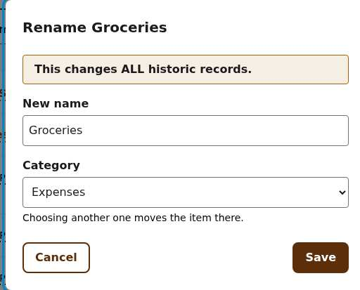

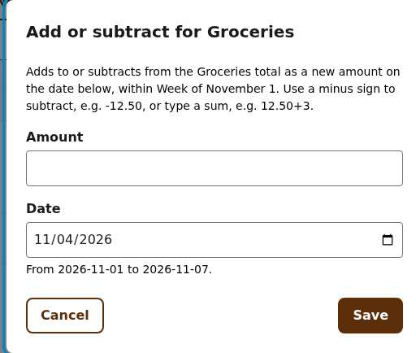

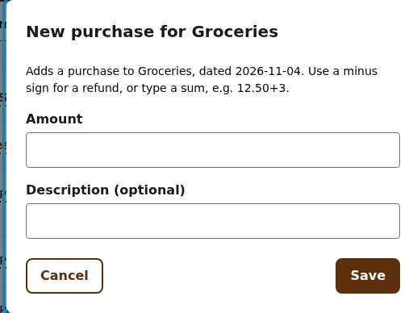
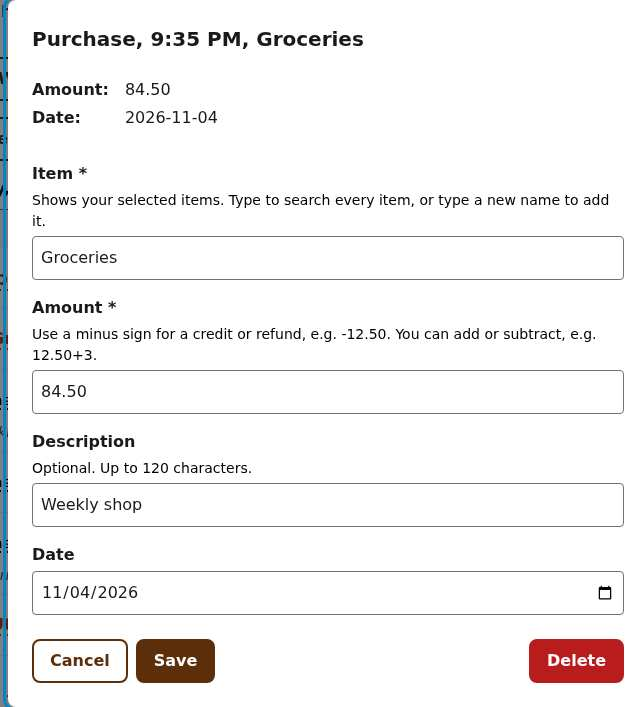

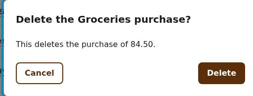

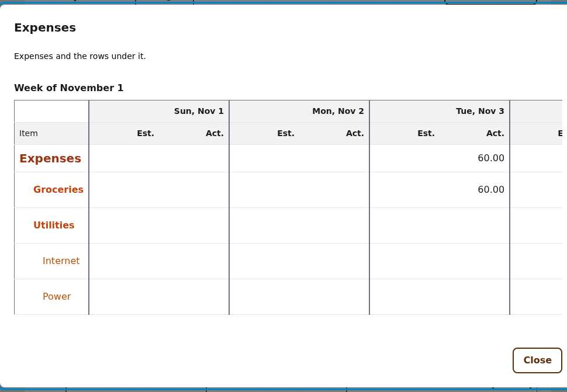

*Top to bottom: three 512px dialogs, the 640px purchase dialog (different footer), the
confirm (primary Delete), and the highlight.*

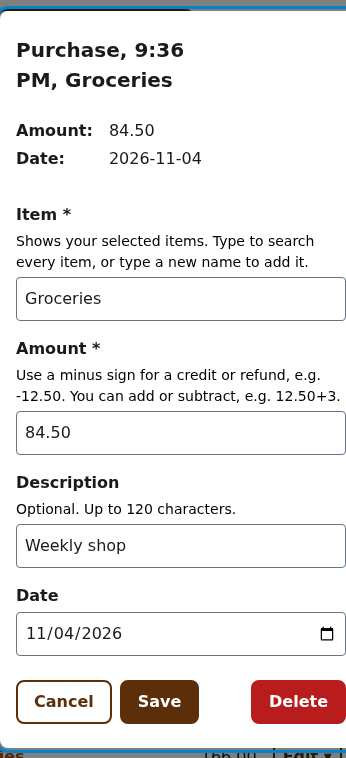

### Onboarding wizard

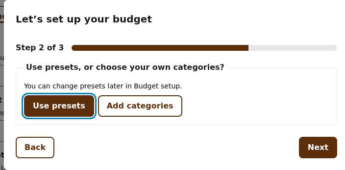
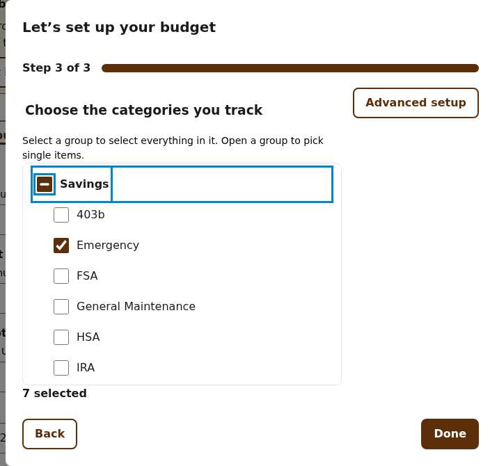

Observed: step 3's heading "Choose the categories you track" is a 20px legend that sits about 4px to the right of the text below it; the "Advanced setup" button sits top right (0009 §1) while Back and Done sit at the bottom.

### Budget setup

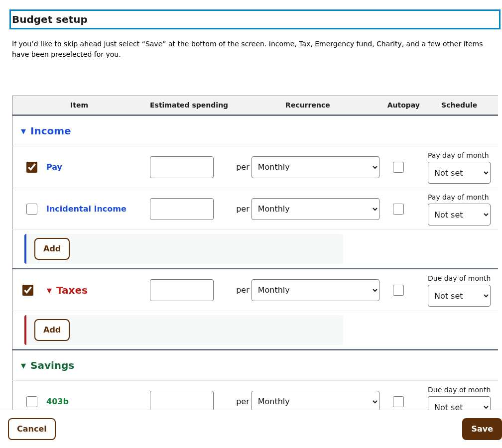

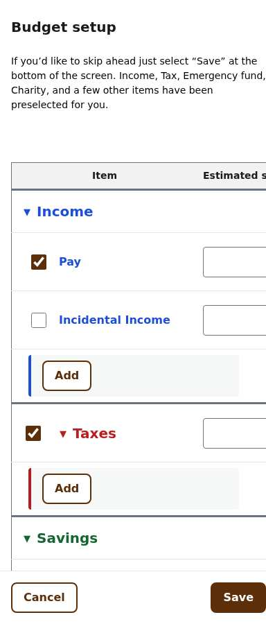

Observed: a tinted strip with a colored left border holds each category's Add button;
columns are Item / Estimated spending / Recurrence / Autopay / Schedule, then Move up and
Move down; the footer is sticky. The Schedule labels use small text
(14px) while other labels are 16px bold.

## 6. Tables

Observed (Day, Week, Month, Annual):

| Property | Day | Week | Month | Annual |
|---|---|---|---|---|
| Columns | Item, Actual, Edit | per day: Estimated, Actual; Edit | per period | per month; rename pencil |
| Item column | 60%, table min 500px, fixed layout | auto, narrow | auto | auto |
| Show estimates checkbox | no (no estimates) | yes | yes | no |
| Row action | `Edit ▾` menu on categories, `Edit` on purchases | `Edit ▾` | `Edit ▾` | pencil icon |

- Row types: depth 0 20px bold category colour; depth 1 bold; depth 2 normal; purchases 14px with an italic description below; indentation 32 / 48 / 64 (16 per level, doubled).
- Borders: 1px under rows, 2px solid vertical line between periods (0008 §4), outline
  1px grey. Header grey fill, sticky.
- Name = 2px dotted underline button; chevron = separate 44px button.
- Negative amounts red; "Edit ▾" is 69px wide and the purchase "Edit" 56px, so the Edit column's buttons do not align (G10).
- In Week the Item column is narrow enough that a row with children puts the chevron above the name (the Expenses and Utilities rows in the image are taller than Groceries). The roadmap's 250px minimum is meant to fix this.
- Annual rename is a pencil; every other table uses a text button "Edit" (G9).
- At 400px the Day table scrolls sideways and the Actual column is clipped; the date
  navigation wraps so the Next button sits alone on its own line (G11).

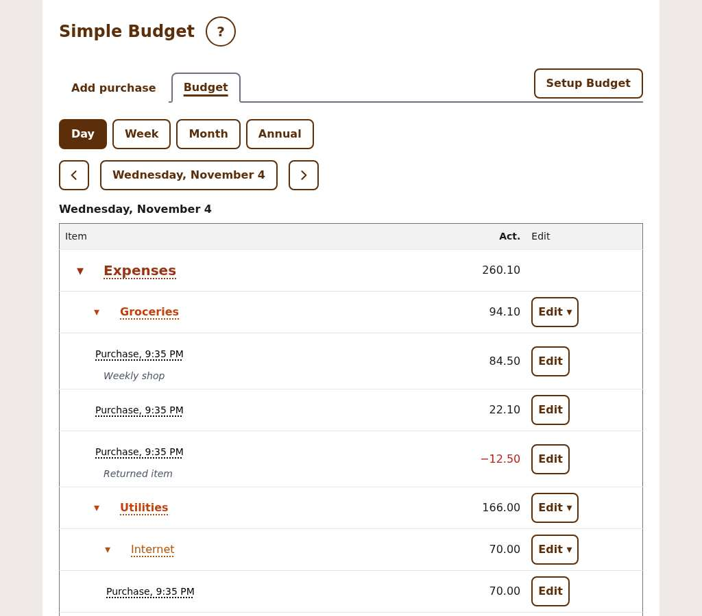

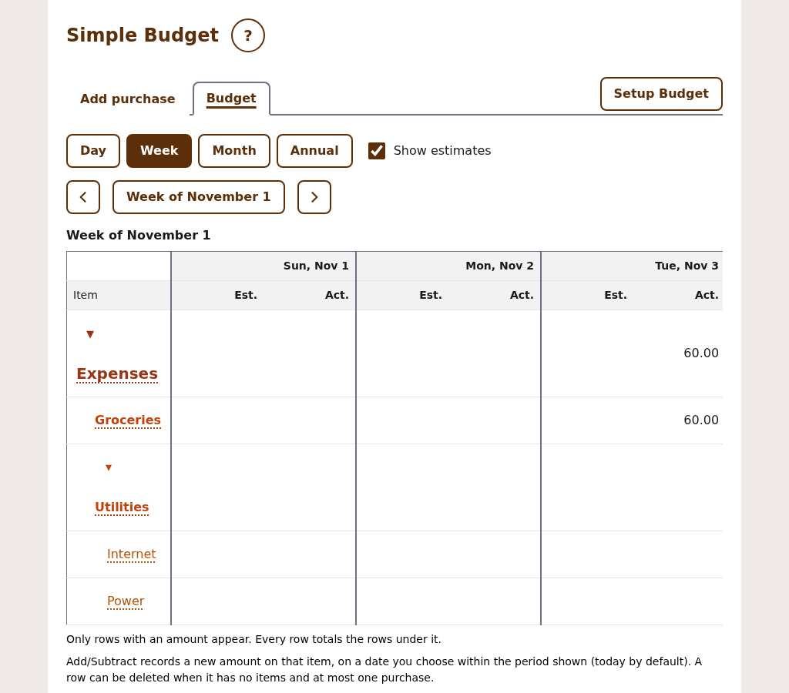

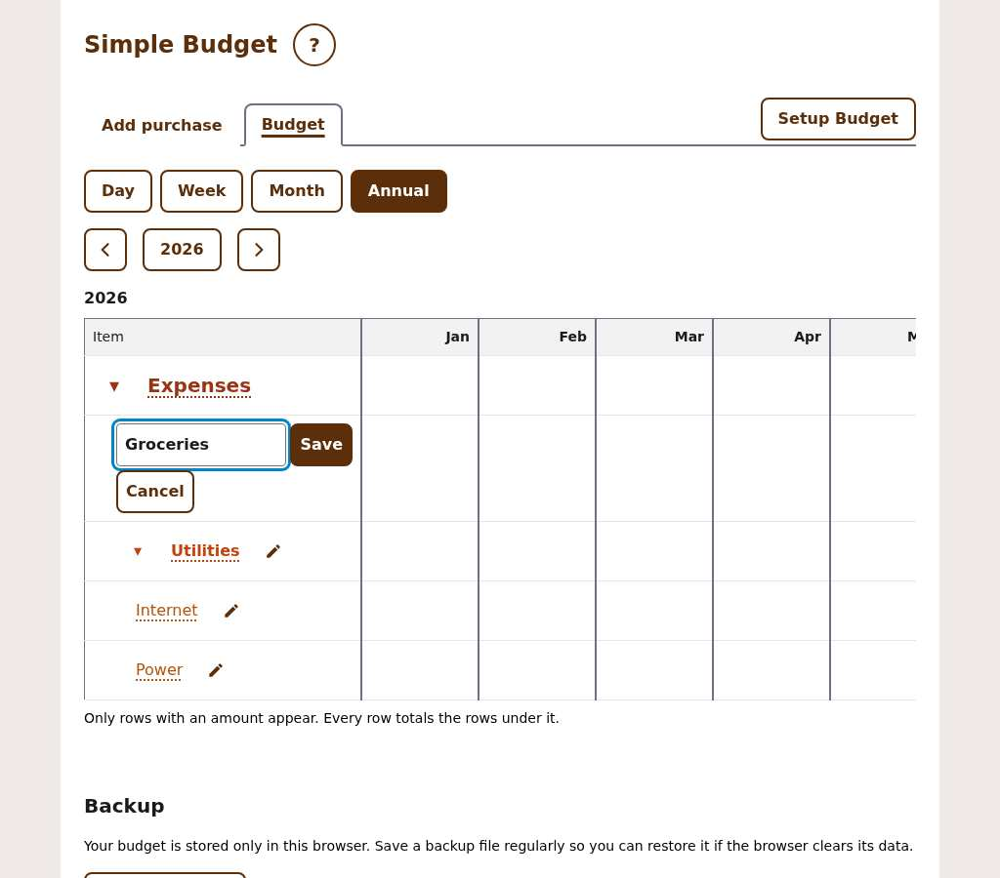

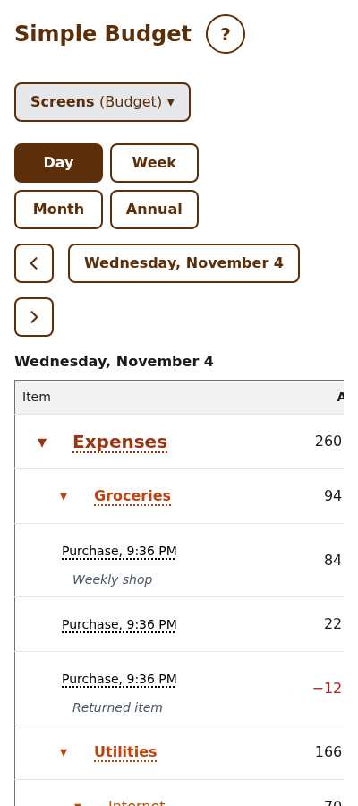

## 7. Messages

Observed (`.banner` variants):

| Kind | Look | Used for |
|---|---|---|
| Error | red border, red tint, "Error:" title | storage failures, form error summary |
| Warning | amber border and tint | skipped records, storage may be cleared, Rename warning |
| Info | blue border and tint | Charity moved |
| Success | green | "Saved" |

- Banners use `h2` titles except in dialogs, where the Rename warning is a `p`.
- `.status` text is green bold; it is used for a refusal in Annual ("Groceries can't be
  deleted yet…"), which reads as success (G12).
- Banner padding 8 / 16, radius 4; no icon on any banner, so colour is the only cue beyond the title (G13). Decided: add icons, below.

**Banner icons (decided 2026-11-06, G13).** Icons are decorative (`aria-hidden`); the title text stays, and the shape carries the kind so colour is never the only cue. Colours come from this app's tokens.

| Kind | Global rule (any app): allowed icons | This app uses |
|---|---|---|
| Info | (i) in a circle, or a lightbulb | lightbulb |
| Warning | (!) in a triangle | (!) in a triangle |
| Error / Alert | (!) in an octagon | (!) in an octagon |
| Success | star, checkmark, target with an arrow in the centre, or thumbs up | thumbs up |

## 8. Navigation and chrome

Observed: title row (h1 and round "?" help button); tabs "Add purchase" / "Budget" with "Setup Budget" as a button at the right of the strip; below 640 the tabs become one "Screens (Budget) ▾" menu; range buttons Day / Week / Month / Annual; date navigation (chevron, title button, chevron); Backup section below the tables.

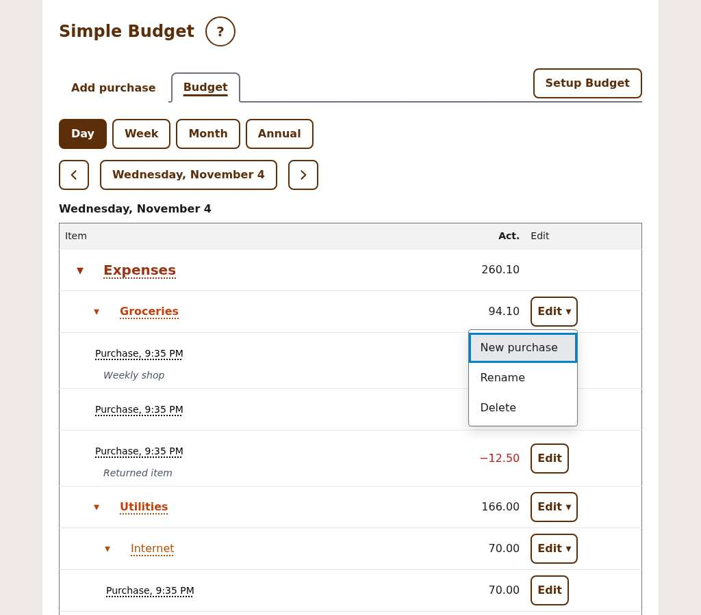

## 9. Accessibility notes that constrain the standards

Carried from the project rules: 44×44 targets, visible focus, sticky removed in narrow
viewports and focus never hidden by sticky content, announcements through the single live
region, no keyboard shortcuts in the budget tables (v0.5.9), no abbreviations.

## 10. Gaps and questions

Each has a recommendation. Answers from 2026-11-06 are marked on the row; the rest are still open. The decided standards are not in the roadmap yet (G18 is open), so none of them is scope.

| # | Question | Recommendation |
|---|---|---|
| G1 | Are `color-mix` tints (90% vs 92%) a standard, or should they be tokens? | Tokens, one tint for all four banner kinds. **Decided 2026-11-06:** banner tints become a token, one tint for all four kinds. |
| G2 | The 900px column and the planned 1440px: does 1440 apply to tables only, or the whole page including forms? | Tables and dialogs up to 1440; forms keep their own max (G4). **Decided 2026-11-06:** the 1440px maximum applies to the whole page; tables may be wider than the content and scroll sideways inside it (reading, to confirm: the page stops at 1440 and wide tables scroll within it). |
| G3 | Delete button colour: danger red everywhere, or red only for permanent loss? | Red for every Delete. **Decided 2026-11-06:** red for every Delete. |
| G4 | Widths: should Amount and Date be narrower than text fields, and what is the max text field width? | Text up to 40rem; Amount 10rem; Date 12rem. **Decided 2026-11-06:** the maximum field width is 100% of the container minus its margin (no 40rem limit). **Decided 2026-11-08:** the rule applies to all form controls (Amount and Date included) by default; a different width is allowed only as an explicit part of a project's design. Added to the global component rules (`components.md`). |
| G5 | Mark required (`*`) or optional ("(optional)")? | Optional is rarer here (Description). Mark required with `*` and add "(optional)" nowhere. **Decided 2026-11-06:** mark required fields (`*`); do not mark optional ones. |
| G6 | Dialog widths: one rule? | Small 32rem (one or two fields), medium 40rem (forms with 4+ fields), large 64rem (tables), wizard follows medium. **Decided 2026-11-06:** small 32rem, medium 40rem, large 64rem; the wizard follows medium. |
| G7 | Footer layout: Cancel left and confirm right always? Where does a secondary Delete go? | Cancel left, confirm right; Delete is a separate danger button at the far left of the footer, away from Save. Or: Delete in the purchase dialog opens the confirm (already does) and leaves the footer Cancel / Save. **Decided 2026-11-08:** option 1. The purchase dialog keeps `[Cancel][Save] ··· [Delete]` (red Delete far right, per G3); mockups: [option 1](images/0012/g7-option-1.jpg), [option 2, not chosen](images/0012/g7-option-2.jpg). |
| G8 | New purchase dialog: include a date field like Add/Subtract? | Yes, same field and rules as Add/Subtract. **Decided 2026-11-06:** yes. |
| G9 | Annual rename: dialog or inline? Pencil icon or an "Edit" text button? | Dialog and an "Edit" text button, like the other tables. **Decided 2026-11-08:** keep the pencil icon, but it opens the same Rename dialog as the other tables (no inline form). |
| G10 | Edit column: one button width for "Edit ▾" and "Edit"? | Same min width (e.g. 5rem) in all tables. **Decided 2026-11-06:** one shared minimum width. |
| G11 | At 400px: should the date navigation keep Previous, title, Next on one line, and should the Day table wrap rather than scroll? | Yes to the nav; the 250px item minimum already forces scroll, so keep scroll but pin the Actual column. **Decided 2026-11-06, for now:** keep Previous, title and Next on one line; pin the Actual column in Day. Testing may change this. |
| G12 | A refusal message ("can't be deleted yet") — green status or the info/warning banner? | Info banner (not red; nothing failed). **Decided 2026-11-06:** info banner. |
| G13 | Add icons to banners? | Yes, a decorative icon per kind; keep the text. **Decided 2026-11-06:** yes; icons per §7. |
| G14 | The Budget setup dialog is a fourth, separate dialog implementation. Fold it into the v0.7 consolidation? | Yes; it is the one the shared component must cope with (full screen, sticky footer). **Decided 2026-11-06:** Budget setup joins the dialog consolidation. |
| G15 | Highlight dialog: table scrolls sideways with Edit off-screen at 1024px. Hide the Estimated and Actual columns' extra periods, or put Edit in the Item column? | Put Edit next to the name in the dialog (one column fewer). **Decided 2026-11-06:** put Edit next to the name in the highlight dialog. |
| G16 | Label size: Schedule and Create-row labels (14px) in Budget setup versus 16px elsewhere. | One label size (16px bold) except the table headers. **Decided 2026-11-06:** one label size, 16px bold. |
| G17 | Wizard step 3 heading indentation and button placement (Advanced setup top right). | Align the heading to the list; keep the button (decided in 0009 §1). **Decided 2026-11-06:** align the heading to the list; keep Advanced setup top right. |
| G18 | Which of these should be roadmap items, and in which version? | Your call. **Decided 2026-11-08:** one "Design standards pass" item in v0.7 that references this doc (added to the roadmap). |

Not covered (could not check): dark theme (none exists), print, Month table (same
structure as Week), keyboard focus order of every dialog, high-contrast mode, 320px width.
